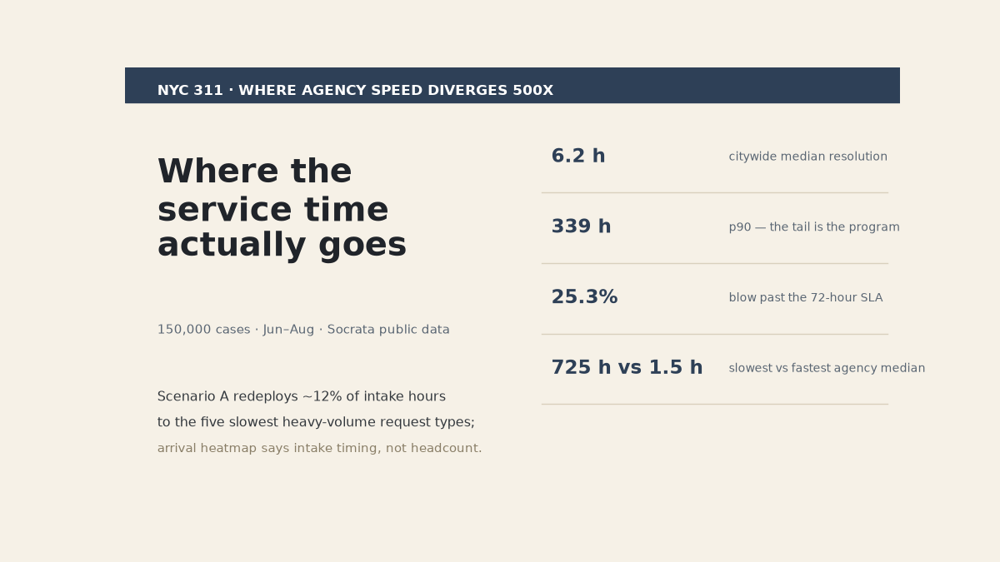

# NYC 311: where a quarter's service hours went



> Memo format, because this one reads like a deputy-commissioner briefing:
> 150k cases in, one quarter, public Socrata feed — and agency medians that
> diverge by a factor of ~500.

## The short version

- Some agencies close at a **1.5-hour median**. The slowest heavy-volume agency runs
  at **725 hours**. That gap is the improvement program, not a rounding error.
- Citywide: median **6.2 h**, p90 **339 h**, and **25.3%** of cases blew past the
  72-hour SLA (36,285 of 143,306 closed).
- Arrival volume peaks in the evening — which argues for an intake *shift* design
  before it argues for extra headcount.
- Backlog at snapshot: **4.5%** of the quarter still open.

## Two costed scenarios

| scenario | what | costed as |
|---|---|---|
| A — redeploy | move ~12% of intake hours to the 5 slowest heavy-volume complaint types | staff-hours, assumptions in `outputs/scenarios.json` |
| B — SLA sweep | clear the >72h queue down to a 35% target | explicit, not asserted |

Every dollar figure traces to a written assumption; none is hidden in code.

## How this ran

- `src/00_download_data.py` — Socrata pull, projected columns, `$limit=150000`, no PII.
- `src/01_analysis.py` — timestamps parsed, open cases stay backlog, `resolve_h` only
  exists for closed ones. Agency/type/borough medians + day×hour heatmap.
- `src/02_bottleneck_scenarios.py` — volume-weighted Pareto on time sinks.
- `src/03_ai_insights.py` — LLM briefing from verified kpis only.
- `src/04_dashboard.py` — single-file `dashboard/index.html`, PDF export.
- `src/05_banner.py` — the image at the top of this file.

## Try it

```bash
python3 -m venv .venv && .venv/bin/pip install -r requirements.txt
.venv/bin/python src/00_download_data.py    # data is also already in data/raw
.venv/bin/python src/01_analysis.py

.venv/bin/python src/06_chat.py "slowest agencies"     # one-shot chat
.venv/bin/python src/06_chat.py                        # or the REPL
```

The chat re-computes answers live from the project's files — slowest agencies,
medians, backlog, top types, busiest hour, boroughs, both scenarios. Sample real
answer: DCWP closes at a 725-hour median, NYPD at 1.5 h. Set `GROQ_API_KEY` in
`.env` and the LLM narrates those facts (never computes); no key and the offline
engine answers identically.


## Caveats

One quarter, one city → directional. Scenario values ride on stated labor
assumptions until a time study hardens them. The LLM only writes; `kpis.json` and
`scenarios.json` are the numbers.
